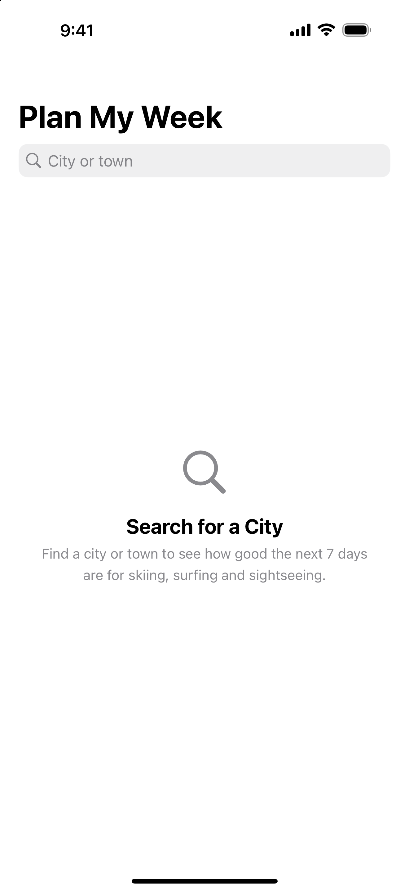
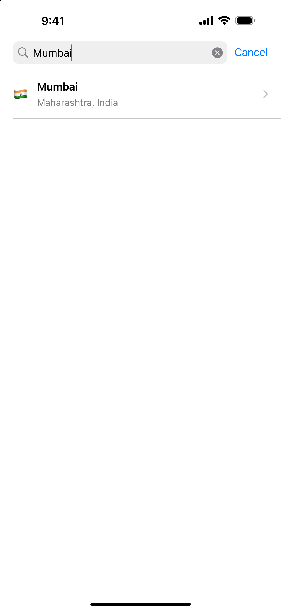
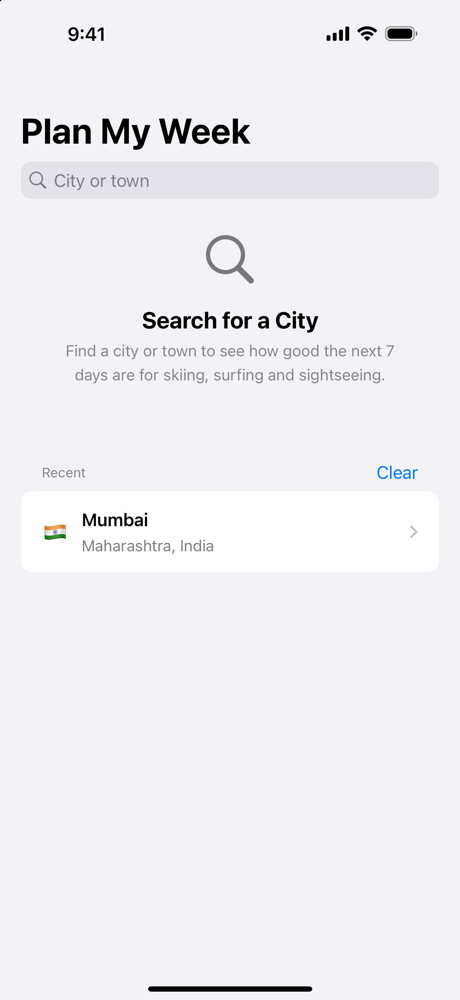
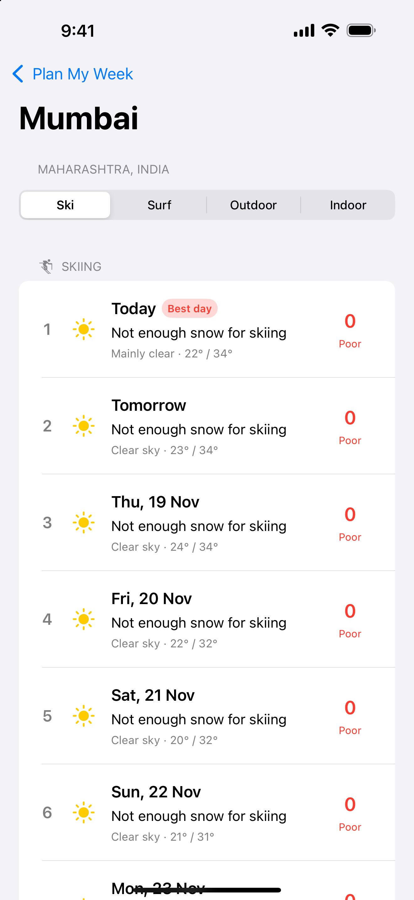
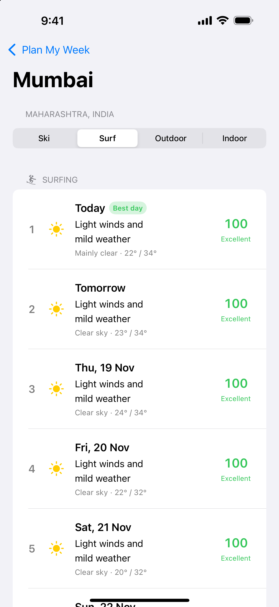
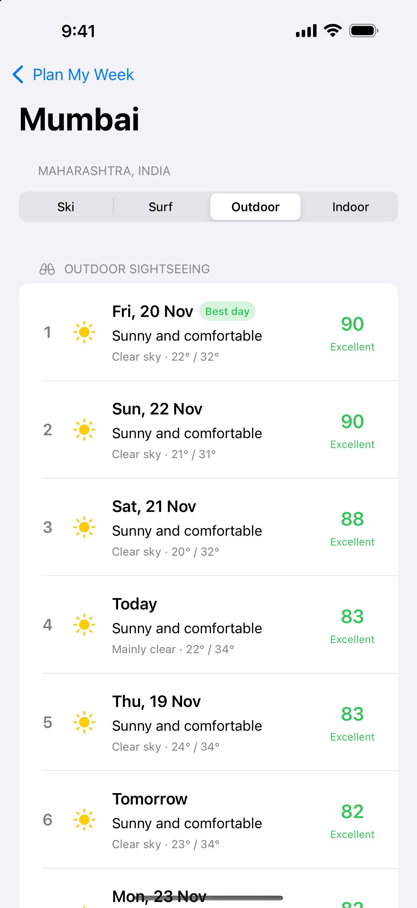
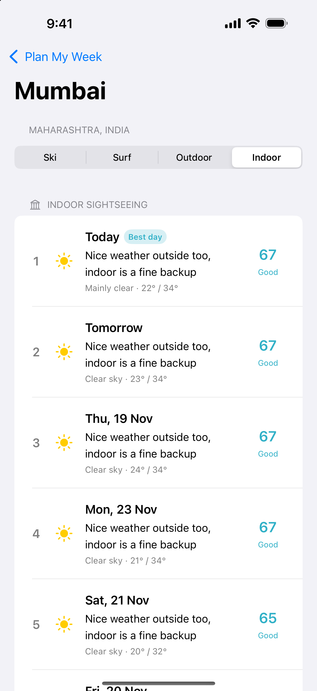

# Plan My Week

An iOS app that lets you search for a city or town and ranks how suitable each of the next 7 days is for:

- Skiing
- Surfing
- Outdoor sightseeing
- Indoor sightseeing

Weather data comes from [Open-Meteo](https://open-meteo.com) (free, no API key):

- [Geocoding API](https://open-meteo.com/en/docs/geocoding-api) for city search
- [Forecast API](https://open-meteo.com/en/docs) for the 7-day forecast

## Requirements

- Xcode 16 or later (the project uses folder-synced groups)
- iOS 17.0+
- Swift 6, SwiftUI, no third-party dependencies

## Running

1. Open `PlanMyWeek.xcodeproj`.
2. To run on a device, select your team under *Signing & Capabilities* and change the bundle identifier (`com.example.PlanMyWeek`). The simulator needs no signing changes.
3. Run the `PlanMyWeek` scheme.

From the command line:

```bash
xcodebuild build -project PlanMyWeek.xcodeproj -scheme PlanMyWeek -destination 'platform=iOS Simulator,name=iPhone 16 Pro'
```

## Using the app

1. Type a city or town in the search field. Results appear after a short pause.
2. Tap a result to open its 7-day ranking.
3. Pick an activity (Ski, Surf, Outdoor, Indoor). The days re-rank instantly, and the top day is marked "Best day".
4. Pull down to refresh the forecast.
5. Cities you open are listed under **Recent** on the home screen (up to 10, newest first, kept between launches). Tap one to go straight to its ranking. Swipe left to remove a city, or tap **Clear** to remove them all.

## Forecast data used

Daily: `weather_code`, `temperature_2m_max/min`, `precipitation_sum`, `rain_sum`, `snowfall_sum`, `precipitation_probability_max`, `wind_speed_10m_max`, `wind_gusts_10m_max`, `sunshine_duration`.
Hourly: `snow_depth` (reduced to the daily maximum).

Times are requested in the location's own time zone (`timezone=auto`).

## How days are scored

Each day starts at 100 for an activity and loses points for unsuitable weather. The final score (0–100) maps to a rating:

| Score | Rating |
|---|---|
| 80–100 | Excellent |
| 60–79 | Good |
| 40–59 | Fair |
| 0–39 | Poor |

- **Skiing**: needs snow on the ground (snow depth) and rewards fresh snowfall. Loses points for warm temperatures, rain, strong gusts, very heavy snowfall, fog and thunderstorms.
- **Surfing**: loses points for strong wind and gusts, cold air, heavy rain, snow, fog and thunderstorms. The Forecast API has no wave data, so this is weather-only.
- **Outdoor sightseeing**: best when dry, sunny, light winds and 12–28 °C. Loses points for rain chance and amount, cold, heat, wind, little sunshine, snow, fog and thunderstorms.
- **Indoor sightseeing**: always at least decent (60+) and rises as outdoor conditions get worse. Loses a little for weather that makes getting around hard (heavy snow, storm gusts, thunderstorms).

The days for each activity are ranked from highest to lowest score. Ties go to the earlier day.

## Screenshots

Taken on an iPhone 16 Pro Max simulator for **Mumbai, Maharashtra, India** (forecast for 17–23 Nov 2026).

| Home | Search results | Home with recent city |
|---|---|---|
|  |  |  |

| Skiing | Surfing | Outdoor sightseeing | Indoor sightseeing |
|---|---|---|---|
|  |  |  |  |

## How this project was built

### Built with Claude Code

I built this app with [Claude Code](https://claude.com/claude-code), Anthropic's AI coding tool. I described the app, asked for a phased plan before any code was written, and reviewed each phase before the next one started. Claude Code wrote the code and checked it: it built the app, ran the logic against live Open-Meteo data, and took the screenshots in the simulator.

### Phases

| Phase | What was built |
|---|---|
| 1 + 2 | Xcode project setup, plus the API layer: Geocoding and Forecast clients, data models and error handling. These were combined into one phase. |
| 3 | The scoring engine: a 0–100 score per day for each activity, rating bands and the ranking |
| 4 | The city search screen, with a short pause after typing before searching, and loading, no-results and error states |
| 5 | The 7-day ranking screen: activity picker, ranked days, "Best day" tag and pull to refresh |
| Follow-ups | Recent cities on the home screen, the search prompt kept visible, a weather icon fix, and screenshots |

### Assumptions

- **The forecast for the searched city stands for the activity.** The app uses weather at the city's coordinates, not at a specific ski resort or beach.
- **Forecast API only.** Surfing is judged on wind and weather alone. The app has no wave data and can't tell whether a place is on the coast, which the surfing note in the app explains.
- **Daily values are detailed enough.** Hourly data is used only for snow depth, reduced to each day's maximum.
- **The 7 days start today in the city's own time zone.** Units are °C, mm, cm and km/h.
- **The ranking matters more than the exact number.** Scores are meant for comparing days within the week, not as a precise forecast.

### Trade-offs

- **Simple rules over a complex model.** Each day starts at 100 and loses points for bad conditions. This is easy to understand and gives a clear reason for every score. The cost is that the thresholds (for example, outdoor sightseeing is best at 12–28 °C) are judgement calls, not tuned on real data.
- **No Marine API.** This keeps to the requested APIs and avoids a second dependency, but makes surfing less accurate.
- **No unit tests.** This kept the project small and quick to change. The logic was instead checked with one-off scripts against live data during development.
- **No caching or offline mode.** Every forecast is fetched fresh, which is simpler and always current, but needs a connection.
- **UserDefaults for recent cities.** A list of up to 10 small items doesn't need a database such as SwiftData.
- **Indoor score depends on the outdoor score.** Indoor sightseeing is never bad, so it scores higher when the weather outside is worse. This keeps the two consistent.
- **"Best day" is always shown.** The top day is tagged even when every day is Poor (for example, skiing in Mumbai), so the screen behaves the same for every activity.

### Design decisions

- **SwiftUI with MVVM.** Views are kept simple. `@Observable` view models hold the state, and the scoring code is separate from the UI.
- **Swappable weather service.** Screens talk to a `WeatherService` protocol rather than to Open-Meteo directly, so another provider or test data could be plugged in.
- **Swift 6, iOS 17, no third-party libraries.** Everything uses Apple frameworks and `URLSession` with `async/await`.
- **Search that keeps up with typing.** It waits 300 ms after typing stops, and a newer search cancels the older one, so results never arrive out of order and cancelled searches never show an error.
- **A clear reason for every score.** Each day shows the main thing holding its score back, or a positive reason when it scores 80 or more.
- **Simple, native UI.** The app uses a list, a segmented picker, the system's empty-state screens, and colour-coded ratings: green Excellent, teal Good, orange Fair, red Poor.
- **Dates in the city's time zone.** "Today" and "Tomorrow" are based on the searched city, not on the phone's location.
